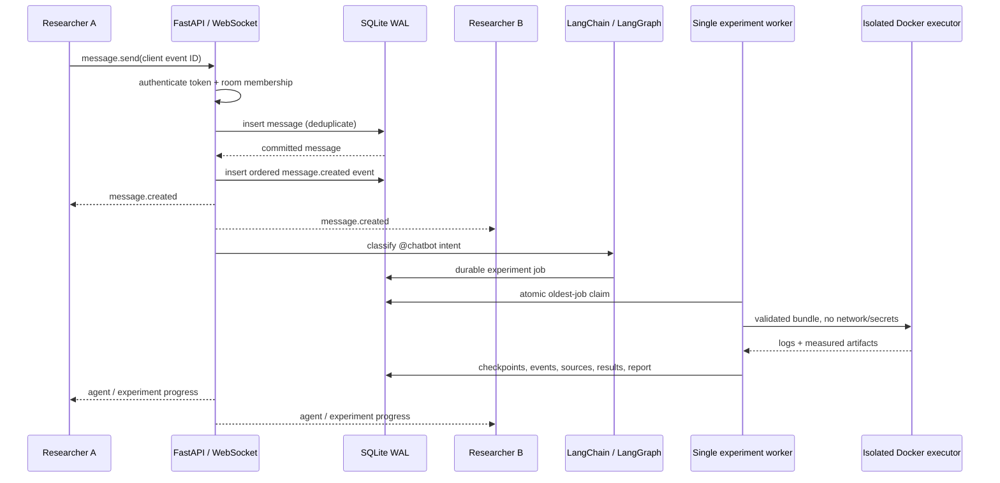

# CausalForge architecture

## Trust boundaries

The browser receives an opaque session token from `POST /api/session`. A room WebSocket is accepted only when that token is valid and its participant is present in `room_members`. The backend takes the participant from the session and the room from the URL; it ignores any user or room IDs in client payloads.

Invite URLs carry the room ID and invite code. After local sign-in, the frontend exchanges both through the join endpoint and removes them from the address bar. Invite codes authorize initial membership; room data REST endpoints repeat the same membership check. This is an appropriate local prototype boundary; production should add a real identity provider, invite expiry, rate limits, audit export, and secret rotation.

## Real-time data path



Messages are committed before broadcast. Each persistent room event gets an auto-incrementing sequence. Reconnecting clients send their latest sequence and receive later events in `message.history`. A unique `(room_id, sender_id, client_message_id)` constraint provides message deduplication.

The initial deployment uses an in-process connection manager. Multiple API processes would require Redis pub/sub for cross-instance fan-out while preserving SQLite/PostgreSQL persistence as the source of truth.

## Room concurrency

Short room-agent requests are serialized per room. Autonomous experiments use a global SQLite queue. `BEGIN IMMEDIATE` makes claims atomic, while an OS file lock ensures only one worker process can own the queue. The worker executes one experiment at a time across all rooms; queue position remains visible.

## Research and experiment path

```mermaid
flowchart LR
  Q[@chatbot experiment request] --> S[OpenAlex + optional Tavily]
  S --> P[Typed plan]
  P --> C[Code bundle]
  C --> V[Static + schema validation]
  V --> D[Isolated Docker run]
  D -->|failure, max 2| B[Bounded model repair]
  B --> V
  D --> E[Measured-output + procedure verification]
  E --> R[Report + artifacts + room result]
```

Only messages containing `@chatbot` activate the agent. Answer/search requests use a LangChain Deep Agent with OpenAlex and optional Tavily tools. Evidence questions are answered by a room-authorized local LangChain tool over persisted experiment records; local paths and execution logs are not sent to an external model, and chat history is never treated as execution proof. Suggestion requests retain the proposal workflow. Direct run/reproduce/repeat requests create an autonomous job immediately. The LangGraph is typed and persists a checkpoint after each node. Private chain-of-thought is never sent over WebSockets; only instrumented stages, concise events, logs, and results are published.

Every generated and repaired bundle is persisted before validation. Validation errors are supplied to the repair model as structured, actionable diagnostics; unchanged repairs are rejected and may trigger one bounded targeted regeneration. After a successful process exit, the evaluator verifies artifact hashes, the metrics and run-metadata contracts, raw result row counts, and requested seed/training/simulation counts. A zero exit code alone cannot produce a completed status.

## Executor boundary

Generated code must implement `experiment.py --config ... --output-dir ...` and write `metrics.json` plus `run_metadata.json`. Prevalidated templates demonstrate that contract. AST checks reject disallowed imports, dynamic execution, dunder access, undeclared dependencies, and network requests; safe standard-library modules such as `warnings` are explicitly allowlisted. The container runs as UID 65532 with `--network none`, a read-only root filesystem, all capabilities dropped, `no-new-privileges`, bounded CPU/RAM/PIDs/files/runtime/output size, a tmpfs, and only server-created source/output mounts. No model or search credentials enter the container. Missing Docker or a missing image fails the job; there is no host fallback.

## Optional Photon adapter

Photon remains isolated behind `PHOTON_ENABLED`. It can ingest and reply to supported Photon Spaces, but it is not part of website messaging, presence, replay, or scientific search. The default is off.
