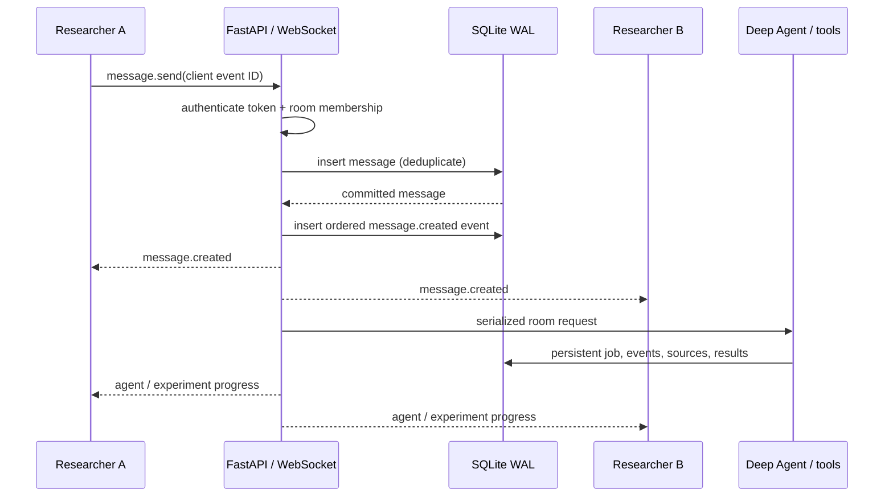
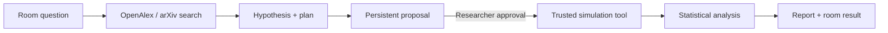

# CausalForge architecture

## Trust boundaries

The browser receives an opaque session token from `POST /api/session`. A room WebSocket is accepted only when that token is valid and its participant is present in `room_members`. The backend takes the participant from the session and the room from the URL; it ignores any user or room IDs in client payloads.

Invite URLs carry the room ID and invite code. After local sign-in, the frontend exchanges both through the join endpoint and removes them from the address bar. Invite codes authorize initial membership; room data REST endpoints repeat the same membership check. This is an appropriate local prototype boundary; production should add a real identity provider, invite expiry, rate limits, audit export, and secret rotation.

## Real-time data path

Messages are committed before broadcast. Each persistent room event gets an auto-incrementing sequence. Reconnecting clients send their latest sequence and receive later events in `message.history`. A unique `(room_id, sender_id, client_message_id)` constraint provides message deduplication.

The initial deployment uses an in-process connection manager. Multiple API processes would require Redis pub/sub for cross-instance fan-out while preserving SQLite/PostgreSQL persistence as the source of truth.

## Room concurrency

Only one AI request runs in a room at a time. An asyncio task registry prevents overlapping requests, a per-room lock serializes research/approval transitions, and database status checks prevent duplicate experiment starts. Independent rooms can run concurrently.

## Research and experiment path

Only messages containing `@chatbot` activate the research agent. Answer/search requests use a LangChain Deep Agent with OpenAlex and optional Tavily tools; requests to suggest an experiment enter the proposal workflow; requests to run an experiment approve the latest ready proposal. In no-key mode, a LangChain runnable transparently formats real OpenAlex results. In `deepagents` experiment mode, actual LangChain Deep Agents delegate to three specialist subagents. Approved execution is routed through explicit simulation, statistical-analysis, and report-generation tools. Private reasoning is never sent over WebSockets; only concise stage descriptions are emitted.

## Experiments

Traffic questions use a real static traffic assignment solver. Method of successive averages finds a Wardrop-style equilibrium for a four-node network before and after a zero-cost connector is added. The measured result demonstrates the Braess-paradox mechanism.

ML questions retain the existing real PyTorch experiment: matched flow-matching MLPs on synthetic two-moons, evaluated with held-out flow regression error and RBF MMD².

Both are bounded trusted implementations. The agent cannot execute arbitrary host code.

## Optional Photon adapter

Photon remains isolated behind `PHOTON_ENABLED`. It can ingest and reply to supported Photon Spaces, but it is not part of website messaging, presence, replay, or scientific search. The default is off.
